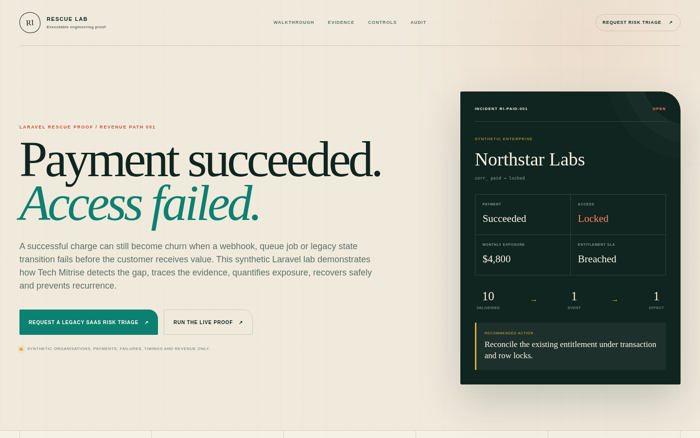

# SaaS Revenue Integrity Rescue Lab

> Payment succeeded. Access failed. The system traced, recovered and stabilised the revenue path safely.




Rescue Lab is a working Laravel demonstration of a revenue-critical SaaS failure: a synthetic customer pays successfully, the provider delivers the same webhook repeatedly, and a queued entitlement job exhausts bounded retries. Access remains locked beyond its SLA until a transactionally safe reconciliation restores it. A second reconciliation is retained as a verified no-op.

Start with the 105-second walkthrough at [`artifacts/rescue-lab-prospect-demo.mp4`](artifacts/rescue-lab-prospect-demo.mp4), then inspect the five core evidence screenshots in [`public/images/proof`](public/images/proof). Technical reviewers can reproduce the same path locally with `make demo`, `make simulate`, `make reconcile`, `make screenshots`, `make video`, and `make test`.

## Tech Mitrise rescue method

The lab makes one legacy-modernisation method inspectable:

1. **Detect** the gap between successful payment and delivered customer value.
2. **Trace** payment, webhook, queue and entitlement state through one correlation trail.
3. **Quantify** the affected synthetic account, SLA breach and revenue exposure.
4. **Recover safely** under transaction, row-lock and uniqueness controls, then verify a repeat no-op.
5. **Prevent recurrence** with signature verification, persistent inbox, idempotency, bounded retries and operational evidence.

The lab sells the investigation and rescue method. It is not itself a commercial SaaS product.

## Evidence boundary

Every organisation, user, plan, subscription, invoice, payment, provider event, delivery, failure, timing, and revenue figure is synthetic lab evidence. The project has no external billing connection and does not claim real recovered customer revenue.

The implemented guarantee is:

> At-least-once event delivery with an idempotent, effectively-once business effect.

The project does not claim distributed exactly-once delivery.

## Stack

- Laravel 13 on PHP 8.5
- MySQL 8.4 as the system of record
- Valkey 8 as the Redis-compatible queue and Horizon store
- Laravel Horizon 5.48 and a dedicated Compose worker
- Blade, Vite 8, and framework-free browser JavaScript
- PHPUnit 12 and Playwright desktop/mobile coverage

## First run

Docker Desktop and `make` are the only host requirements.

```bash
make demo
```

The command refreshes dependencies in Docker when required, starts Laravel/MySQL/Valkey/Horizon, generates `APP_KEY` only when absent, applies migrations, creates the synthetic fixture only when absent, installs frontend dependencies and pinned Chromium, and builds assets.

Open the public proof page at [http://localhost:18080/proof](http://localhost:18080/proof). Select **Run the 8-action rescue**, or open [http://localhost:18080/app](http://localhost:18080/app) directly:

```text
Email: operator@rescuelab.test
Password: rescue-demo
```

These credentials are synthetic, local-only defaults. Replace the seeded identity before any public deployment.

## Guided journey

Start with **Guided live incident** above the evidence tabs. Its eight controls persist one action at a time: successful payment, ten deliveries of one webhook, three queue failures, SLA detection, safe repair, and repeat no-op verification. The live facts and evidence tabs reload from MySQL after every action.

1. **Rescue Control Room:** connect the technical failure to Northstar Labs, USD 4,800 synthetic monthly exposure, and locked access.
2. **Customer Incident:** follow the actions just performed using stored correlation IDs.
3. **Root Cause:** inspect at-least-once delivery, the failed entitlement job, and the breached access SLA.
4. **Safe Recovery:** verify locked-to-active before/after state and the immutable repaired/no-op actions.
5. **Fragile vs Stabilised:** compare the same synthetic scenario with and without signature, inbox, idempotency, uniqueness, retry, and reconciliation controls.
6. **Engineering Evidence:** resolve product claims to tests, architecture, commands, and the runbook.

## Buyer proof package

| Asset | Location | Purpose |
| --- | --- | --- |
| Walkthrough MP4 | [`artifacts/rescue-lab-prospect-demo.mp4`](artifacts/rescue-lab-prospect-demo.mp4) | Captioned 105-second failure-to-recovery proof. |
| Narration script | [`docs/launch/WALKTHROUGH.md`](docs/launch/WALKTHROUGH.md) | Human voice-over script and shot list for the same MP4. |
| Screenshot index | [`docs/launch/SCREENSHOT_INDEX.md`](docs/launch/SCREENSHOT_INDEX.md) | Captions and links for the six 1440 x 900 application frames. |
| Core screenshots | [`01`](public/images/proof/01-rescue-control-room.png), [`02`](public/images/proof/02-customer-incident-timeline.png), [`03`](public/images/proof/03-root-cause-evidence.png), [`04`](public/images/proof/04-safe-recovery-before-after.png), [`05`](public/images/proof/05-repeat-no-op-proof.png) | Required evidence sequence: paid-but-locked, trace, divergence, recovery and no-op. |
| Scenario study | [`docs/SCENARIO_STUDY.md`](docs/SCENARIO_STUDY.md) | Synthetic business context, evidence, diagnosis, intervention and verified result. |
| Critical Software X-Ray sample | [`docs/CRITICAL_SOFTWARE_XRAY_SAMPLE.md`](docs/CRITICAL_SOFTWARE_XRAY_SAMPLE.md) | Compact paid-diagnostic sample derived from the Lab evidence. |
| Three-minute sales path | [`docs/THREE_MINUTE_SALES_DEMO.md`](docs/THREE_MINUTE_SALES_DEMO.md) | Internal demo script, qualification questions and Audit transition. |
| Architecture | [`docs/ARCHITECTURE.md`](docs/ARCHITECTURE.md) | Critical revenue path, constraints, queue and reconciliation design. |
| Runbook | [`docs/OPERATIONS.md`](docs/OPERATIONS.md) | Local startup, scenario operations, recovery, rollback and release checks. |
| Release audit | [`docs/RELEASE_AUDIT.md`](docs/RELEASE_AUDIT.md) | Verification commands, results and release boundary. |

## Scenario commands

```bash
make simulate   # replay fragile and stabilised paths
make reset      # restore the active paid-but-locked incident
make reconcile  # repair once and verify the repeat no-op
make test       # run the complete local quality gate
make video      # create a narrated-caption prospect MP4 and poster in artifacts/
make screenshots # regenerate six 1440 x 900 application proof frames
make proof-assets # regenerate screenshots, README image and social preview
```

Equivalent Artisan commands are `lab:simulate`, `lab:reset`, and `lab:reconcile --verify-no-op`.

## Safety controls

- HMAC verification with an explicitly synthetic local signing credential
- Persistent delivery ledger plus unique provider event and delivery constraints
- Idempotent consumer and guarded subscription state transitions
- One entitlement per workspace/subscription/key
- Transaction and row locking around provisioning and reconciliation
- Three bounded job attempts with `[1, 5, 15]` second backoff
- Horizon and persisted provisioning-attempt visibility
- Immutable reconciliation actions with before/after snapshots
- Workspace-derived reads and mutations
- Production defaults to read-only proof; all synthetic mutation routes share an explicit opt-in middleware gate
- MySQL and Valkey are not bound to host ports
- `.env`, dependencies, compiled assets, logs, and test artifacts are ignored

## Verification

```bash
./vendor/bin/sail pint --test
./vendor/bin/sail test
./vendor/bin/sail npm run build
./vendor/bin/sail npm run test:e2e
./vendor/bin/sail composer audit --locked --no-interaction
./vendor/bin/sail npm audit --audit-level=low
```

The mandatory tests are in [`tests/Feature/PaidAccessRescueTest.php`](tests/Feature/PaidAccessRescueTest.php), [`tests/Unit/RevenueIntegrityAuditorTest.php`](tests/Unit/RevenueIntegrityAuditorTest.php), and [`tests/Browser/revenue-rescue.spec.js`](tests/Browser/revenue-rescue.spec.js). GitHub Actions repeats the same release gates in [`.github/workflows/ci.yml`](.github/workflows/ci.yml).

## Architecture and operations

- [Architecture](docs/ARCHITECTURE.md) documents event ingestion, queue processing, constraints, tenancy, detection, and reconciliation.
- [Operations](docs/OPERATIONS.md) is the setup, deployment, rollback, failed-job, reconciliation, and incident-response runbook.
- [Synthetic scenario study](docs/SCENARIO_STUDY.md) explains the fictional business context, evidence inspected, diagnosis, intervention and verified result.
- [Critical Software X-Ray sample](docs/CRITICAL_SOFTWARE_XRAY_SAMPLE.md) shows the compact paid-diagnostic output derived from the lab evidence.
- [Three-minute sales demonstration path](docs/THREE_MINUTE_SALES_DEMO.md) gives the internal short-demo script and qualification questions.
- [Prospect demo](docs/PROSPECT_DEMO.md) provides an accurate five-minute walkthrough.
- [Current state](docs/CURRENT_STATE.md) states what is implemented and what remains outside the lab boundary.
- [Release audit](docs/RELEASE_AUDIT.md) records the observed public release-candidate checks and external deployment boundary.
- [GitHub launch runbook](docs/GITHUB_LAUNCH.md) contains repository settings, placeholder replacement, branch protection and first-release commands.
- [Launch copy](docs/LAUNCH_COPY.md) provides accurate GitHub, proof-page and prospect-call messaging.
- [EOD launch control center](docs/launch/README.md) links the walkthrough, Audit, proposal, demo-call, Upwork, outreach, fact-intake and freeze packages.

## Contributing and security

The project is available under the [MIT License](LICENSE). See [CONTRIBUTING.md](CONTRIBUTING.md) before proposing changes and [SECURITY.md](SECURITY.md) for private vulnerability reporting guidance. The [changelog](CHANGELOG.md) records the release surface.

## Limitations

- The payment provider and failure adapter are deterministic simulations.
- The lab accepts only its synthetic signed webhook contract.
- Reconciliation activates a synthetic entitlement; it does not call a real provider.
- No public signup, commercial billing, production identity provider, or customer-data import exists.
- Set `RESCUE_LAB_DEMO_MUTATIONS_ENABLED=true` only for an isolated synthetic demonstration, never against production customer data.
- A production deployment still requires approved infrastructure, secrets, TLS, monitoring, backups, and an operator access policy.
- No deployment, remote push, or external service configuration is performed by this repository.
